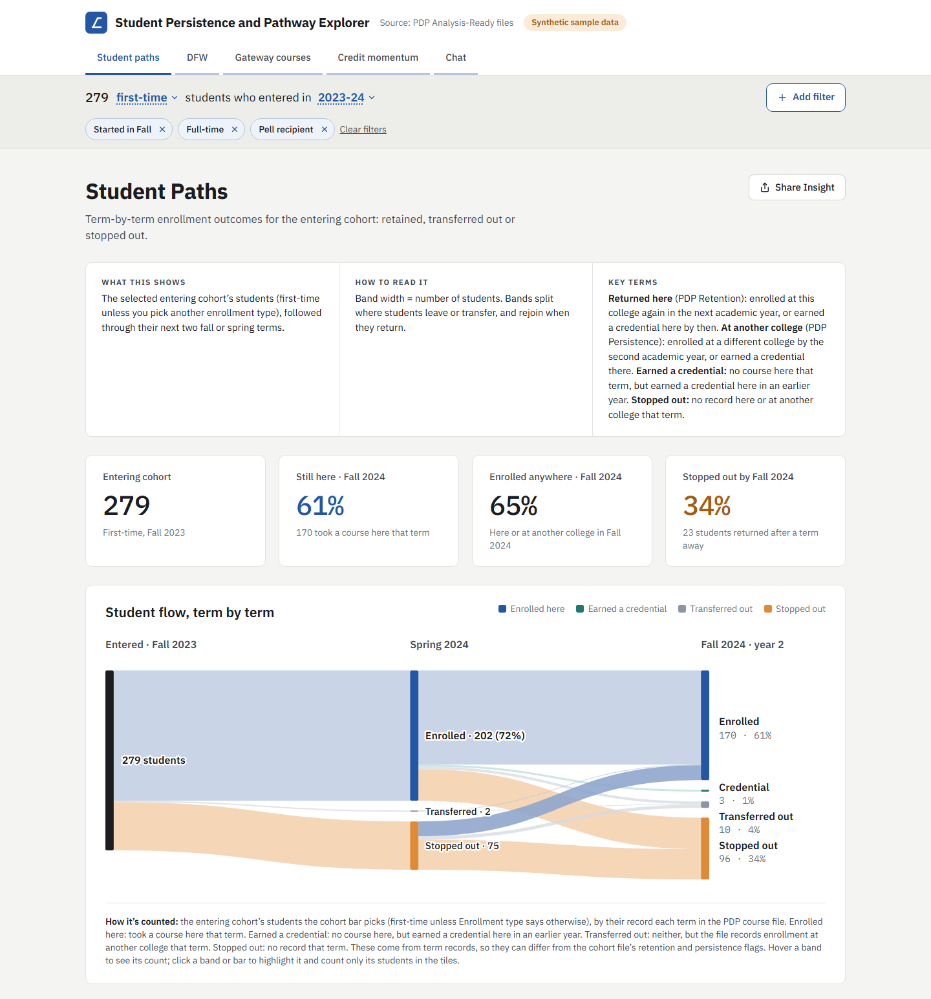
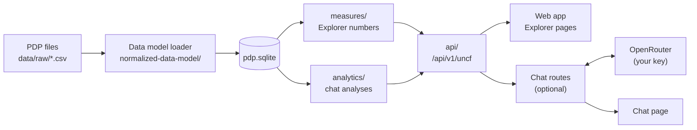

# Student Persistence and Pathway Explorer

> **Status: not maintained.** Built during the 2026 Higher Endeavor Datathon and released as-is
> under the MIT License. We don't accept issues or pull requests. To build on it, fork it.

The Student Persistence and Pathway Explorer is a web app that helps advising, student success and
institutional research staff at a college explore how a cohort of students is doing. It reads a
college's Postsecondary Data Partnership (PDP) analysis-ready files and shows retention, student
paths term by term, DFW rates by course, gateway math and English completion, and credit momentum.
Every number comes with its plain-language definition, numerator and denominator. Each page
downloads as a PDF report, and the API returns any page's numbers as CSV. An optional chat answers
graduation, retention, enrollment and exploration questions with the same calculations, and shows
how each answer was worked out. It was built for two UNCF member institutions, Florida Memorial
University and Benedict College, and works with any institution's PDP files.

**This repository runs on synthetic (mock) data only.** Nothing it shows is a finding about real
students or institutions.



## How it works



The loader turns the PDP files into one SQLite database. Python in `measures/` and `analytics/`
calculates every number from it on each request. The API only checks requests and returns JSON or
CSV, and the web app only draws. The chat's language model picks an approved analysis; it never
produces the numbers. Components, data flow and the API reference: [docs/architecture.md](docs/architecture.md).

## Prerequisites

| Tool | Version | Used for |
| --- | --- | --- |
| [Git](https://git-scm.com/) | any recent | Cloning |
| [mise](https://mise.jdx.dev) | 2026.10 or newer | Installs the pinned tools below |
| bun | 1.4.3 (pinned by mise) | Web app packages and scripts |
| Node.js | 24 (pinned by mise) | Web app runtime |
| Python | 3.14 (pinned by mise) | Playground server |
| uv | 0.13 (pinned by mise) | Playground server packages |
| Python | 3.10 or newer, separately | Only for the root tools and tests (`measures/`, `analytics/`, the data model) |

No database server, Docker or cloud account is needed for the Explorer. Versions are pinned in
[playground/mise.toml](playground/mise.toml), [requirements.txt](requirements.txt),
`playground/server_application/uv.lock` and `playground/client_application/bun.lock`.

**Tested with:** Windows 11 (Git Bash) and Ubuntu (CI), Python 3.12.4 (root) and 3.14 (Playground),
Node 24.15.0, bun 1.4.4, mise 2026.10.12, on 2026-11-23.

## Quick start on the mock data

Two terminals, about 10 minutes the first time.

**Terminal 1: the server**

```bash
git clone https://github.com/devcolor/pdp-persistence-pathway-explorer.git
cd pdp-persistence-pathway-explorer/playground
mise trust && mise install
mise run api:install     # server packages
mise run api:load        # builds normalized-data-model/output/pdp.sqlite from data/raw/ (about a minute)
mise run api:dev         # API on http://localhost:8000, docs at http://localhost:8000/docs
```

**Terminal 2: the web app**

```bash
cd pdp-persistence-pathway-explorer/playground
mise run web:install
mise run web:dev         # Explorer on http://localhost:3000
```

Open http://localhost:3000/uncf/paths. The tabs are Student paths, DFW courses, Gateway courses and
Credit momentum. Pick a cohort, add filters, and use **Share Insight** to download the page as a
PDF. For a page's numbers as CSV, add `format=csv` to its API call, for example
http://localhost:8000/api/v1/uncf/gateway?cohort=2022-23&format=csv.

On Windows, if a `mise run` task fails, run it from Git Bash (mise uses `cmd` there).

**Run the tests** (from `playground/`):

```bash
mise run api:test
```

The root Python tools have their own tests. From the repository root, with Python 3.10 or newer:

```bash
python -m venv .venv
source .venv/bin/activate        # Windows: .venv\Scripts\activate
python -m pip install -r requirements.txt
make check-fast                  # no make (Windows)? python scripts/check.py && python data/quality/run_checks.py
```

**Optional: turn on the chat.** Create `playground/server_application/.env.development.local`
(git ignores it) with your own [OpenRouter](https://openrouter.ai) key, restart `mise run api:dev`,
and open http://localhost:3000/uncf/chat:

```bash
OPENROUTER_API_KEY=your-openrouter-key
```

Try "What is the retention rate for all majors?" Without a key, the Explorer pages work and the
chat shows a configuration message.

## Use your own PDP files

The bundled mock files, from [Achieving the Dream](https://achievingthedream.org/):

| File | Rows | Columns | What it is |
| --- | ---: | ---: | --- |
| [pdp_cohort_data.csv](data/raw/pdp_cohort_data.csv) | 10,313 | 85 | One row per student per cohort |
| [pdp_course_data.csv](data/raw/pdp_course_data.csv) | 100,951 | 35 | One row per student per course per term |

Don't replace them. Keep your own export outside the repository and load it from the repository
root, with the root `.venv` active:

```bash
python -m api load --cohort /secure/pdp/cohort.csv --course /secure/pdp/course.csv
```

That rebuilds `normalized-data-model/output/pdp.sqlite`, which every page and the chat read.
**Never commit real student data:** PDP exports are protected by FERPA. Column names, data fixes,
data coverage and the checklist before real data goes in are in the
[integration guide](docs/integration.md).

## Environment variables, accounts and keys

Nothing is required to run the Explorer on the mock data.

| Account or key | Needed for | Where it goes |
| --- | --- | --- |
| [OpenRouter](https://openrouter.ai) key, `OPENROUTER_API_KEY` | Chat only | `playground/server_application/.env.development.local` (git-ignored) or your host's secret store |

Adopters need their own OpenRouter account and pay their own costs. Chat sends the question text to
OpenRouter and the model you pick, so check that provider's terms before real use.

Every setting, with its default, is in the [integration guide](docs/integration.md#4-settings) and
in the `.env.example` files: [root tools](.env.example),
[Playground server](playground/server_application/.env.example) and
[web app](playground/client_application/.env.example). Never put a real value in a committed file.

## Deploy options

Bring your own hosting. There is no hosted demo. The [integration guide](docs/integration.md#6-hosting)
has the steps for both:

- **Your own server** (recommended for real data): the API and the built web app as two services
  behind nginx.
- **Vercel:** [vercel.json](vercel.json) deploys the web app, API and chat as one project. It turns
  chat on unless you turn it off.

Before real student data goes on any host, it needs sign in, a privacy (FERPA) and IT review, and
the data owner's sign-off.

## Known issues and limitations

- Runs only on synthetic data so far. A real PDP export has not been tried.
- The mock data has known bugs, and some definitions (federal retention, grade lines, credit
  milestones) are team choices an institution must confirm.
- No sign in, and small groups are shown, including groups of one.

The full list: [docs/known-issues.md](docs/known-issues.md). What each folder holds:
[docs/architecture.md](docs/architecture.md#components).

## Credits

Built by the UNCF squad of /dev/color fellows:

- Beza Woldegebriel ([@bwold001](https://github.com/bwold001))
- Daryl Sistrunk ([@sistrund](https://github.com/sistrund))
- Fuad Mohamoud ([@ProgrammingFuad](https://github.com/ProgrammingFuad))
- Stella Berhe ([@stillgit](https://github.com/stillgit))

With thanks to:

- Florida Memorial University and Benedict College, the UNCF member institutions it was built for.
- [Achieving the Dream](https://achievingthedream.org/), for the mock data.
- /dev/color, for the datathon's shared starter repository: its normalized data model, success
  measures, Playground and gap finder.

## License

Code: [MIT](LICENSE). Data: see [data/README.md](data/README.md#where-it-came-from).

---

### About the 2026 Higher Endeavor Datathon

The Higher Endeavor Datathon, run by [/dev/color](https://www.devcolor.org/) with support from the
Gates Foundation, brought fellows together with colleges and intermediary networks to build open
prototypes on Postsecondary Data Partnership data. Each squad released its prototype as a public,
unmaintained repository. Find them all under the
[higher-endeavor-datathon-2026](https://github.com/topics/higher-endeavor-datathon-2026) topic.
