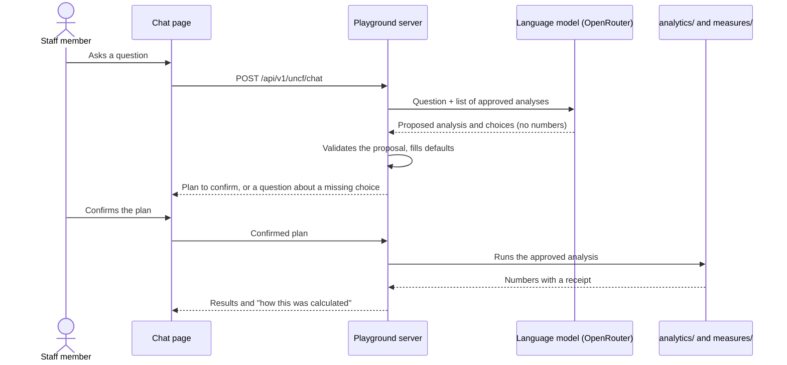

# Architecture

How the Student Persistence and Pathway Explorer is put together: what each part does, how data
moves from the PDP files to the screen, and where each number is calculated. The system diagram is
in the [README](../README.md#how-it-works); this page goes one level deeper. Running it at a school
(settings, hosting, sign in) is in the [integration guide](integration.md).

**All data in this repository is synthetic.** Nothing it shows is a finding about real students or
institutions.

## Components

| Folder | What it is | Runs as |
| --- | --- | --- |
| `data/` | The mock PDP files, their dictionaries, checksums (`manifest.json`) and the mock-data quality log (`quality/`) | Files |
| `normalized-data-model/` | Schema, mapping configs, data fixes, validator and loader that build `pdp.sqlite` | `python -m api load`, or `python -m src.loader.load` from that folder |
| `measures/` | Every Explorer number: one file per measure in `calculations/`, the page breakdowns in `breakdowns/`, and the plain-language definitions in `definitions.py` | Python library |
| `analytics/` | The chat's deterministic analyses (graduation, retention by major, annual enrollment), bounded exploration statistics (`analytics/exploration/`), program attribution, data-coverage rules, the shared plan service and calculation receipts | Python library |
| `api/` | One FastAPI router under `/api/v1/uncf`: request checks, response shapes, CSV export | `python -m api` (port 8001), or mounted by the Playground server |
| `playground/server_application/` | The Playground FastAPI server. Mounts the `api/` router and adds the chat routes (`app/chat/`) | `mise run api:dev` (port 8000) |
| `playground/client_application/` | The Next.js web app: the Explorer pages and the chat page | `mise run web:dev` (port 3000) |
| `chat_app.py` | A separate entry point that serves only the chat routes, for hosting chat on its own | Optional |
| `gap_finder/` | Group comparisons (equity gaps) from the starter | Python library |

## Data flow, step by step

### 1. ARF CSV → normalized model

`python -m api load` runs the loader in `normalized-data-model/`. On the mock data it reads the
sources in `normalized-data-model/config/pipeline.yaml`; with `--cohort` and `--course` it reads a
school's two files through `api/config/school_pipeline.yaml`. For each run the loader:

1. **Maps** each CSV column to its table and column (`config/cohort_mapping.yaml`,
   `config/course_mapping.yaml`).
2. **Fixes** known mock-data bugs (`config/data_fixes.yaml`), such as course codes that lost a
   leading zero.
3. **Validates** each value against `config/destination_schema.yaml` and holds back rows that
   break a rule (they are listed in `normalized-data-model/logs/`).
4. **Loads** ten tables (`student`, `cohort_membership`, `term`, `course`, `course_enrollment`,
   and others) in one transaction. If anything fails, the old database stays as it was.

The full refresh takes about 30 seconds to a minute and needs about 650 MB of memory at its peak.
The table diagram is in [normalized-data-model.mmd](../normalized-data-model/normalized-data-model.mmd).

### 2. Normalized model → numbers

| Kind of number | Where it's calculated | Notes |
| --- | --- | --- |
| Retention (school and federal), persistence | `measures/calculations/` | `retention_type=school` uses the PDP retention flag; `federal` means took a course here the fall after year 1 |
| Gateway math and English completion | `measures/calculations/`, page in `measures/breakdowns/` | Passed on the first try and in the end: a C or better (2.0) or a P |
| DFW rate (D, F, withdrawal) | `measures/calculations/`, page in `measures/breakdowns/` | Split into D, F and W, which add up to the total |
| Credit completion and credit momentum | `measures/calculations/`, `measures/breakdowns/credit_progress.py` | 12/24/30-credit milestones and pace toward a degree |
| Student paths (term by term status) | `measures/breakdowns/` | Here, earned a credential, enrolled elsewhere, stopped |
| Plain-language definitions | `measures/definitions.py` | A school's own names for a measure go in `LOCAL_NAMES` |
| Chat: graduation, retention by major, annual enrollment | `analytics/` | Each answer has a receipt: formula, population, counts, exclusions, data coverage |
| Chat: exploration (group summaries, mean comparisons, correlations) | `analytics/exploration/` | Over one row per student for year 1 (`student_year1`), with fixed features and groups, at most four steps and twenty groups per step |
| Group gaps | `gap_finder/` | Shared starter tool |

Every result uses one shape: measure, filters, numerator, denominator, rate, status, limitations,
definition, source and load time. A missing value stays empty with a reason; it's never shown as 0.
Results are cached in memory and recalculated when `pdp.sqlite` changes. Nothing is saved.

### 3. Numbers → API → screen

| Page | Route in the web app | API it calls |
| --- | --- | --- |
| Student paths | `/uncf/paths` | `GET /api/v1/uncf/student-paths` |
| DFW courses | `/uncf/dfw` | `GET /api/v1/uncf/dfw`, `GET /api/v1/uncf/dfw/course` |
| Gateway courses | `/uncf/gateway` | `GET /api/v1/uncf/gateway` |
| Credit momentum | `/uncf/credit-momentum` | `GET /api/v1/uncf/credit-momentum` |
| Chat | `/uncf/chat` | `POST /api/v1/uncf/chat` (same as `/api/v1/chat`) |

Every page route takes the same cohort and filter values and `format=json|csv`, so the numbers
behind any page can be downloaded as CSV from the API. In the web app, **Share Insight** downloads
the page as a PDF. The full endpoint list is in [API reference](#api-reference) below and at `/docs`
on a running server.

### 4. Chat, when it's turned on

- The model can only call the catalog, definitions and approved-analysis tools. No tool accepts
  SQL, student IDs or file paths.
- The person confirms the full plan before anything is calculated.
- Numbers shown come from validated receipts. Any numbers the model writes are thrown away.
- Chat needs an OpenRouter key. Without one, the Explorer pages still work and chat shows a
  configuration message.

More detail: [analysis definitions](analytics-definitions.md),
[v2 contracts](analysis-v2-contracts.md), [chat client contract](chat-v2-client.md) and
[ADR 0001](adr/0001-chat-v2-analysis-boundary.md).

## Where it runs

The web app calls the Playground server by default (`http://localhost:8000/api/v1`), which mounts the
`api/` router and adds chat. `python -m api` serves the same router on its own, without chat. For
the settings each part reads, see the [integration guide](integration.md#4-settings) and the
`.env.example` files.

## API reference

Every page route and `/measures/{measure}` take the same query values: `cohort`, the 8 filters
(`cohort_term`, `enrollment_intensity`, `enrollment_type`, `pell`, `gender`, `race`, `ethnicity`,
`age_band`), `retention_type=school|federal` and `format=json|csv`. For example:
`/api/v1/uncf/gateway?cohort=2022-23&pell=Y&retention_type=federal&format=csv`.

| Endpoint | What it returns |
| --- | --- |
| `GET /api/v1/uncf/student-paths?…&terms=&group_by=` | Each student's status term by term (here, credential, elsewhere, stopped) with shares, moves, transfers, retention and per-group paths |
| `GET /api/v1/uncf/dfw?…` | Everyone's DFW rate with D, F and W apart, then each course. `meta.grade_scale` says which grades count |
| `GET /api/v1/uncf/dfw/course?course=ENG%20101&…` | One course by term, delivery and group, each with `rest_rate` and `gap` against everyone else |
| `GET /api/v1/uncf/gateway?…` | Each gateway course in year 1: students, passed on the first try and in the end, the path after the first try, retention if passed or not, and gaps against everyone else |
| `GET /api/v1/uncf/credit-momentum?…` | Year 1 credits, completion ratio, 12/24/30 milestones, credit tiers with retention, and progress toward a degree |
| `GET /api/v1/uncf/measures/{measure}?cohort=&group_by=` | One measure split by up to two groups: the everyone row, then one row per group. The old `GET /results?measure=` URL still works |
| `GET /api/v1/uncf/options` | The measures and groupings `/measures/{measure}` takes |
| `GET /api/v1/uncf/cohort-options?cohort=` | Students per cohort year, and per filter value in the chosen cohort |
| `GET /api/v1/uncf/definitions` | Every plain-language definition |
| `GET /api/v1/uncf/health` | Whether the data is loaded, and when |
| `GET /api/v1/uncf/analyses/catalog`, `POST /api/v1/uncf/analyses` | The chat's approved analyses, and one analysis with its receipt |
| `/api/v1/uncf/analysis-v2/catalog`, `/validate`, `/execute` | Typed analysis plans ([v2 API guide](analysis-v2-api.md)) |
| `POST /api/v1/chat` (alias `/api/v1/uncf/chat`) | Chat, Playground server only, when turned on. Requests need `protocol_version: 2`; older bodies get 422 |

- **Errors:** 422 for a value the API doesn't offer (`invalid_filter`, `invalid_group_by`,
  `invalid_analysis`), 404 `unknown_course`, 503 `data_missing` or `analytics_unavailable`.
  Bodies are `{"error": {"code", "message"}}`.
- **Missing numbers** stay `null` with a status (unknown, unavailable, not yet observable). Empty
  groups have no rate.
- **`provisional`** is true for the 2024-25 cohort, whose second year is only partly in the data.
- **Small groups** are all shown, including groups of one.

## Hosting

Vercel (`vercel.json`) or your own server: see the [integration guide](integration.md#6-hosting).
