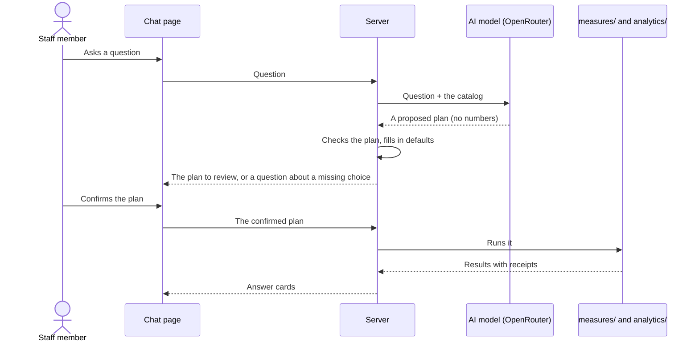

# How the chat works

The chat is an optional part of the Explorer. Staff ask a question in plain words, and the chat
answers it with the same calculations the pages use, showing exactly how each number was worked
out. Turning it on and off, hosting it and choosing an AI service are in the
[integration guide](integration.md#8-chat). What isn't verified yet is in
[known issues](known-issues.md#chat).

**All data in this repository is synthetic.** Nothing the chat shows is a finding about real
students or institutions.

## What it can answer

The chat can only run the analyses in its catalog. There are 18:

| Kind | Analyses |
| --- | --- |
| **The pages' measures** (11) | Retention (school or federal), persistence, DFW rate, DFW by course and one course in detail, credit completion, credit momentum, gateway math and English completion, gateway course outcomes, student paths |
| **Chat-only analyses** (3) | Graduation (four-year, six-year and to date, by credential and program), retention by first-term major, annual enrollment by program and ethnicity |
| **Exploration** (4) | Group summaries, comparisons of averages between groups, correlations between two approved measures, and measure variants (not available yet: they always answer "unavailable") |

It says it can't help, rather than guessing, when a question asks why something happened, asks for
a custom formula, threshold or grouping, asks for individual students, or matches nothing in the
catalog. No part of the chat accepts SQL, student IDs or file paths.

Exploration works on one row per student for their first year (`student_year1`), with fixed
features and groups. Requests can't add expressions, bins or other ways of handling missing values.

## From question to answer



1. **The model proposes, it doesn't calculate.** It reads the catalog and proposes a plan of up to
   four steps. Any numbers it writes are thrown away.
2. **Missing choices become questions.** If the question doesn't say which cohort, credential or
   definition, the chat asks, offering the choices the server allows.
3. **Staff review the whole plan before anything runs**, including known limits in the data (for
   example, "graduation can't be measured for this cohort yet"). Nothing is calculated until they
   confirm. A new question starts a new plan.
4. **The code calculates.** The confirmed plan runs against one consistent read of the database,
   so every step sees the same data. A step that depends on another doesn't run if the first one
   has no usable answer.
5. **The answer is built from receipts**, never from the model's words.

## What an answer shows

Each answer card leads with a plain summary and the exact scope (cohort, filters, definition). Under
"How these results were calculated" it shows the receipt:

- the value, with its numerator and denominator, or the counts and sample sizes behind an average
  or correlation
- who was counted, who was left out and why
- the definition and formula
- the data source, when it was loaded, and what the data is known to cover
- version and fingerprint details that let someone rerun exactly the same calculation

Large tables come in pages of 200 rows, up to 12,800 rows. Past that, the chat asks you to narrow
the question. Nothing is cut off silently.

## Missing, unknown and small results

| Status | Meaning |
| --- | --- |
| A number, including 0 | Calculated. Zero is a real answer |
| Unknown | The data can't establish the outcome |
| Unavailable | A needed source, or a statement about what the data covers, is missing |
| Not yet observable | The cohort hasn't been followed long enough for this horizon |
| Provisional | The answer may change as more terms arrive (the 2024-25 cohort in the sample) |
| Not reported | The data doesn't report it, such as gateway completion for a school that doesn't flag gateway courses |

Every nonempty group is shown, including groups of one, and results that overlap or can be
subtracted from each other are all shown. That's fine for synthetic data and **not** a privacy
protection for real records: see [before real data goes in](integration.md#10-before-real-data-goes-in).
Treat small groups with care. A correlation from two students is always +1 or -1.

## Telling the chat what your data covers

Graduation and annual enrollment need to know which years are complete and how long each cohort was
followed. The chat never guesses this from today's date or the latest year in the data. Declare it
in `analytics/config/analytics.yaml`, or a copy named by `UNCF_ANALYTICS_CONFIG`:

```yaml
complete_academic_years: ["2022-23", "2023-24"]   # years whose enrollment is complete
cohort_followup_years: {"2022-23": 4}              # how many years each cohort was followed
cutoff: "2026-06-30"                               # the data's cutoff date
provenance: "Checked with our institutional research office, fall 2026 release"
provisional_retention_cohorts: ["2024-25"]         # cohorts whose second year isn't complete
```

The sample leaves the first three empty, because the mock files don't say. That's why graduation and
annual enrollment answer "unavailable" on the sample. Only declare what your data provider or
institutional research office has confirmed. Each horizon is judged on its own, and "to date" is
never labeled a four- or six-year rate.

## The chat-only calculations

The page measures are defined in [measures/](../measures/README.md). The three chat-only analyses:

| Analysis | Calculation | Notes |
| --- | --- | --- |
| Graduation, any program | Students who completed a qualifying credential here / eligible entrants in the selected program, credential and cohort | Four-year, six-year and to date are separate. Unknown eligibility, entry program or completion timing is left out and counted |
| Graduation, selected program | Completions in the selected program / eligible entrants with a known completion program | A graduate whose final major is unknown is left out, not counted as another program |
| Retention by first-term major | Retained students / students with a known retention outcome, overall and by first-term major | Uses the PDP retention flag. Unknown majors stay a labeled group |
| Annual enrollment | Distinct students enrolled in a year, by term program and ethnicity | The latest two declared complete years. A student who changes programs can appear in more than one, so program totals overlap. Ethnicity never stands in for race |

- **Entry major** is `program_of_study_term_1` from the cohort file; enrollment uses the term
  program from the course file.
- **Programs** are matched on six-digit CIP codes. The sample registers chemistry two ways:
  Chemistry, General (`400501`) and the chemistry family (`40.05`). Chemical engineering and
  chemistry courses don't make a chemistry major. Programs are listed in `analytics/programs.py`.
- **Graduation by program is unknown on the PDP files.** It needs the semester each award was
  earned, and the files only give a rounded time to credential. Graduation in any program still
  works once follow-up is declared. Don't fill the gap with the last semester a student took
  courses.

The formulas, with their versions, are in `analytics/definitions.py`.

## Limits

| Limit | Value |
| --- | --- |
| Steps in one plan | 4 |
| Groupings | Up to 2 for a page measure, 1 for student paths and for an exploration step |
| Groups in one exploration step | 20 (empty groups don't count) |
| Course rows one exploration step reads | 500,000 |
| Time per calculation step | 10 seconds (`UNCF_ANALYSIS_V2_TIMEOUT_SECONDS`, at most 60) |
| Time for a whole chat answer | 75 seconds; each model call gets 45 |

A plan over a limit is refused as a whole, never trimmed. If a database error or time limit stops a
plan part-way, the answers already finished are kept and the rest are marked as not run.

## Using the analysis API without chat

The calculations behind the chat are also an API that needs no AI model or key and works with chat
turned off. The paths include `analysis-v2` for historical reasons.

| Route | What it does |
| --- | --- |
| `GET /api/v1/uncf/analysis-v2/catalog` | The analyses, their choices, the data's coverage, and the catalog and data references a plan needs |
| `POST /api/v1/uncf/analysis-v2/validate` | Checks a plan and returns the questions it still needs answered, or the exact plan to confirm. Calculates nothing |
| `POST /api/v1/uncf/analysis-v2/execute` | Runs a complete plan and returns results with receipts |

A plan names the catalog and data it was built against, so it can't run on data that has changed
since. Read both references from `GET /catalog` first:

```json
{
  "kind": "executable",
  "catalog_version": "<from GET /catalog>",
  "snapshot_ref": "<from GET /catalog>",
  "steps": [{
    "kind": "defined_measure",
    "step_id": "retention",
    "operation_id": "retention.rate",
    "parameters": {"cohort": "2023-24", "retention_type": "school", "filters": {"pell": "Y"}, "group_by": []}
  }]
}
```

The response's `outcome` is `complete`, `partial` (some steps finished) or `failed`. HTTP status
codes: 200 for results, 422 for a plan the API can't accept, 409 when the data or catalog has
changed (fetch the catalog again), 503 when the data isn't loaded, and 504 when time ran out before
any result. Each run returns a replay record: send it back to `/execute` to rerun the same
calculation on the same data, or get a refusal if that data has been reloaded. Results aren't
cached.

The chat page itself calls `POST /api/v1/uncf/chat` with `protocol_version: 2` in the body.

## Extending it

- **Where code goes.** Page measures live in `measures/`, chat-only analyses in `analytics/`,
  exploration in `analytics/exploration/`, and the shared plan checks and execution in
  `analytics/plan_service.py`. The model's tools are in `playground/server_application/app/chat/`.
  See [AGENTS.md](../AGENTS.md).
- **Adding an analysis.** Define a typed request and a versioned definition, write the calculation,
  add tests with hand-counted expected values, and register it. The catalog allows at most 18
  analyses (`CatalogResponse.operations` in `analytics/plan_contracts.py`), and there are 18 now, so
  raise the limit with the new one; the catalog tests fail until you do.
- **Adding programs.** Add them to `analytics/programs.py`. A suggested question and the graduation
  guidance name chemistry directly; update `analytics/chat_guidance.py` to use the selected program.
- **Tests.** The chat's tests use a scripted model and small hand-counted SQLite files, so they cost
  nothing to run: `make check` from the root, and `mise run api:test` in `playground/`.

## Check a model before you rely on it

The chat depends on the model reading questions correctly and calling its tools correctly. A fixed
set of 41 questions checks this, and it has never run against a live model. Run it before staff use
the chat, and again whenever you change the model or AI service. From
`playground/server_application/`, with `OPENROUTER_API_KEY` set:

```bash
uv run python -m scripts.evaluate_release_b --model "$UNCF_CHAT_MODEL" \
  --database ../../normalized-data-model/output/pdp.sqlite --output model-evaluation.json
```

Any failed question means the model isn't ready. Passing doesn't replace the checks in
[the integration guide](integration.md#check-chat-before-staff-use-it).
